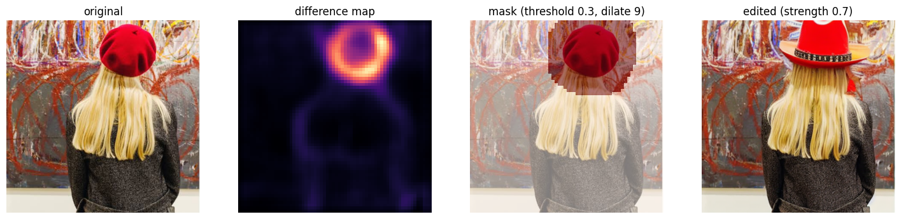
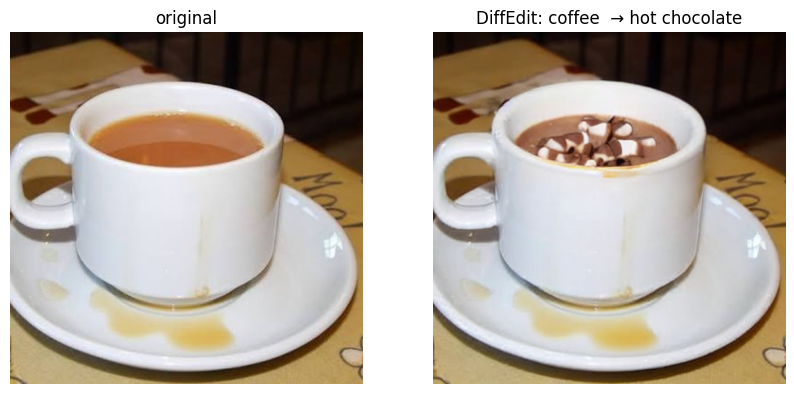

# deep-learning-from-scratch-stable-diffusion

Building a deep learning library from scratch, from matrix multiplication to diffusion models, following [fast.ai Part 2](https://course.fast.ai/Lessons/part2.html).

## Notebooks

| Notebook | Lesson | What's inside |
|---|---|---|
| [stable_diffusion.ipynb](stable_diffusion.ipynb) | 9 | Stable Diffusion pipeline: CLIP text encoder, VAE, U-Net, scheduler, classifier-free guidance |
| [DiffEdit (paper replicating)](DiffEdit(paper_replicating).ipynb) | 11 | Implementing the DiffEdit paper from scratch |

---

## DiffEdit: editing images with text prompts

Implementation of [DiffEdit (Couairon et al., 2022)](https://arxiv.org/abs/2210.11427) using Stable Diffusion v1.4.

You give a photo plus two prompts, e.g. *"a dog sitting on the grass"* → *"a cat sitting on the grass"*. The model **finds the part of the image to change by itself** and leaves everything else untouched. No hand-drawn mask is needed.

### How it works
1. **Find the mask.** Add noise to the image and ask the U-Net to predict that noise twice: once with the reference prompt, once with the target prompt. Where the two predictions **disagree** is the area to edit. This is averaged over several noise samples, smoothed, and thresholded.
2. **Noise the image** partway (controlled by `strength`).
3. **Masked denoising.** Denoise with the target prompt, but at every step paste the original image back **outside the mask**, so only the masked area changes.

### Results

| Image | Edit | Result | Note |
|---|---|---|---|
| Dog | dog → cat | ✅ | needed a low threshold (0.05–0.1) |
| Tea | tea → hot chocolate | ✅ | cup, saucer and table unchanged |
| Shepherd | person → sheep | ✅ | |
| Beret | beret → bowler hat | ✅ | worked at strength 0.5 |
| Beret | colour change only | ❌ | colour-only edits give a weak mask |

### What I learned
- **Threshold is the most important setting.** The difference map is brightest where the prompts differ most (a dog's face), so a high threshold only catches the face. Too low and it leaks into the background.
- **Object and texture changes work, colour changes don't.** "Tea → hot chocolate with whipped cream" works; "tea → black coffee" doesn't, because the model predicts nearly the same noise for both.
- **Small objects are hard.** The mask is made at 64×64 latent resolution, so small regions are only a few pixels. Edges (like a cup rim) light up more than the area itself.
- **Stray blobs.** Background texture adds noise to the mask; keeping only the largest connected region fixes it.
- **Strength vs. surroundings.** Higher strength allows bigger shape changes, but with a large mask it also alters nearby areas.

### Differences from the paper
- The paper uses **DDIM inversion** to noise the image; I used the simpler `scheduler.add_noise`.
- The paper uses threshold 0.5; I found the best value depends on the image (0.05–0.3).

### Run it
Open the notebook in Colab (T4 GPU). Run the main cell, upload a photo, and write a reference prompt and a target prompt.
